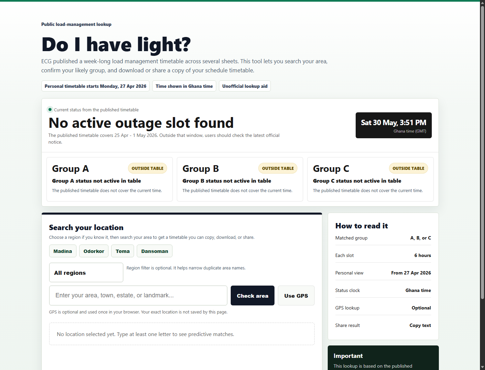

# Do I Have Light?

Do I Have Light? is a fast static lookup tool for Ghana load-management schedules. Users can search for an area or use their location to find the likely ECG group and see the related 6-hour light/off-light schedule.

[Live demo](https://obj7.github.io/do-i-have-lights/)



## What this project does

- Searches embedded ECG load-management grouping data by area and region.
- Shows the current Ghana time and schedule status.
- Supports location-assisted lookup through browser geolocation.
- Uses OpenStreetMap reverse geocoding for GPS area names.
- Produces shareable results for quick public lookup.
- Ships as a static single-page app with no build step.

## Tech stack

- HTML
- CSS
- Vanilla JavaScript
- Browser Geolocation API
- OpenStreetMap Nominatim reverse geocoding
- Netlify-style `_headers` security config

## Data note

The page references the published ECG 800MW load management timetable and grouping file. Personal schedules start from Monday, 27 April 2026.

## Local usage

Open `index.html` directly in a browser, or serve the folder locally:

```bash
npx serve .
```

## Deployment

This project can be deployed as a static site on GitHub Pages, Netlify, Vercel, or any static host. If deploying to Netlify, keep `_headers` in the publish root so the security headers are applied.

## Privacy

Location lookup runs in the browser. GPS lookup uses the user's browser permission prompt and sends coordinates to OpenStreetMap Nominatim for reverse geocoding. The app does not require account login, server-side storage, or secret environment variables.
